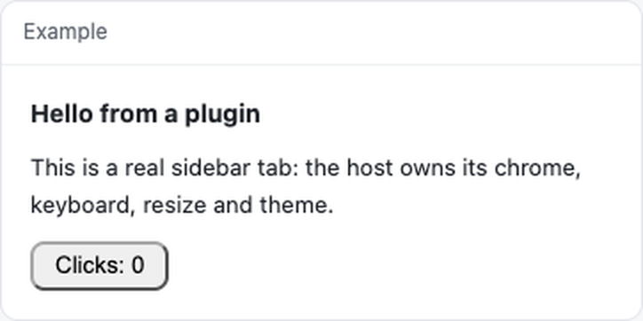

# dsh-plugin-example



[](https://github.com/WJDdidi-1/dsh-plugin-toolkit)

A DeepSeek Harness plugin in ~70 lines: one sidebar tab that says hello and counts clicks. It exists to be read, copied, and installed in one command.

```sh
dsh plugin add dsh-plugin-example
```

## What it shows

| Piece | Where | Why it is worth copying |
| --- | --- | --- |
| The bundle envelope | `client.js` first and last lines | A client plugin is one file calling `window.__ModuleLoader__.load({ id, factory })`. No bundler, no relative imports. |
| The tab | `apply()` → `sidebarRightTabs.register` | `kind` is what the tab is opened by; `title` is a **function**, because it is re-read when the language changes. |
| The body | `slots.register({ name: 'sidebar.right.pane.tab', key })` | The host injects the pane; you render its contents and inherit its theme. |
| Two languages | `COPY` + `ctx.locale.register` | Keys missing from one language fall back to the other, so a half-translated plugin still renders. |
| The host half | `index.js` | Empty here on purpose: a plugin with nothing to serve does not need routes. |

## Run it

From a checkout, the tab runs in Node without the harness:

```sh
npm install
npm run example
```

`examples/render.mjs` mounts the real `client.js` through the same
[`dsh-plugin-toolkit`](https://www.npmjs.com/package/dsh-plugin-toolkit) helper
the test uses, prints what the host would render, clicks the button once, and
prints again:

```text
mounted client.js
  Hello from a plugin This is a real sidebar tab: the host owns its chrome, keyboard, resize and theme. Clicks: 0
clicked [data-testid="bump"] once
  Hello from a plugin This is a real sidebar tab: the host owns its chrome, keyboard, resize and theme. Clicks: 1
```

That is the whole feedback loop: edit `client.js`, rerun, read the text. Point it
at another bundle with `npm run example -- path/to/client.js`. The test below is
the same loop with assertions instead of a printout.

## Check it

```sh
npm run check
```

`check` runs `dsh-plugin verify .`: it packs the tarball, installs it, imports the
host half and mounts the panel **from the installed copy**. `doctor` reads the
working folder and would still pass if `files` forgot `client.js` — verify is the
one that notices. CI runs the same check through
`WJDdidi-1/dsh-plugin-toolkit@v1` with `version: latest`, so the pin below only
affects your own `npm test`.

## Test it

```sh
npm install
npm test
```

The one test mounts the real `client.js` in jsdom with the real React, through [`dsh-plugin-toolkit`](https://www.npmjs.com/package/dsh-plugin-toolkit):

```js
const panel = await mountClient({ file: 'client.js' });
assert.equal(panel.text(), 'Hello from a plugin');
await panel.click('[data-testid="bump"]');
assert.match(panel.text(), /Clicks: 1/);
```

That is the difference between "the bundle parses" and "the button works".

## FAQ

**Does it need a build step?**
No. `client.js` is the file the host loads: it calls
`window.__ModuleLoader__.load({ id, factory })` and gets React through the
host's module loader. There is no bundler and no build output to commit.

**The tab does not appear. What should I check?**
The tab registers as `kind: 'example'` in the right sidebar, so look there
first. It requires harness `>=0.2.0` (the first version with
`sidebarRightTabs`). To see what the host would render without the harness:

```sh
npm install
npm run example
```

**Why does the click count start over at zero?**
`clicks` is a local `useState` in `Panel`, so it exists only while the tab is
mounted. Closing the tab or reloading the window starts a fresh count; this
example does not persist it.

**Can I run the example against my own bundle?**
Yes — `examples/render.mjs` takes a path:

```sh
npm run example -- path/to/client.js
```

Your bundle needs a `[data-testid="bump"]` button for the click step; remove
that block from `examples/render.mjs` if it does not have one.

**Does it need network access, an API key, or extra permissions?**
No. `client.js` and `index.js` make no network calls and read no environment
variables. The dependencies are dev-only, for the test and the example.

## Requirements

| | |
| --- | --- |
| Harness | `>=0.2.0` (the version that ships `sidebarRightTabs`) |
| Node | `>=18`, for the test only |
| Permissions | none: no network, no key, no telemetry |

## License

Apache-2.0.
